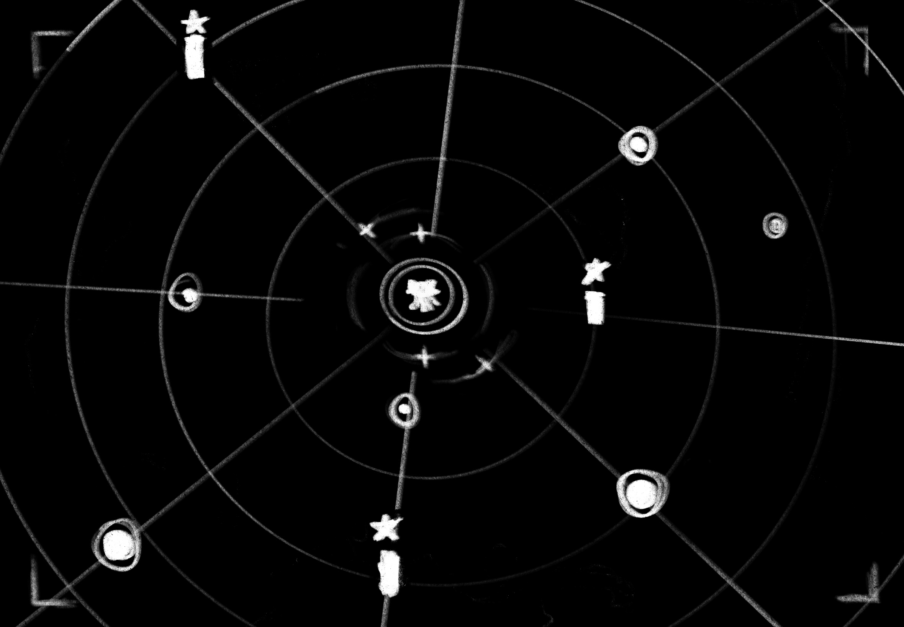
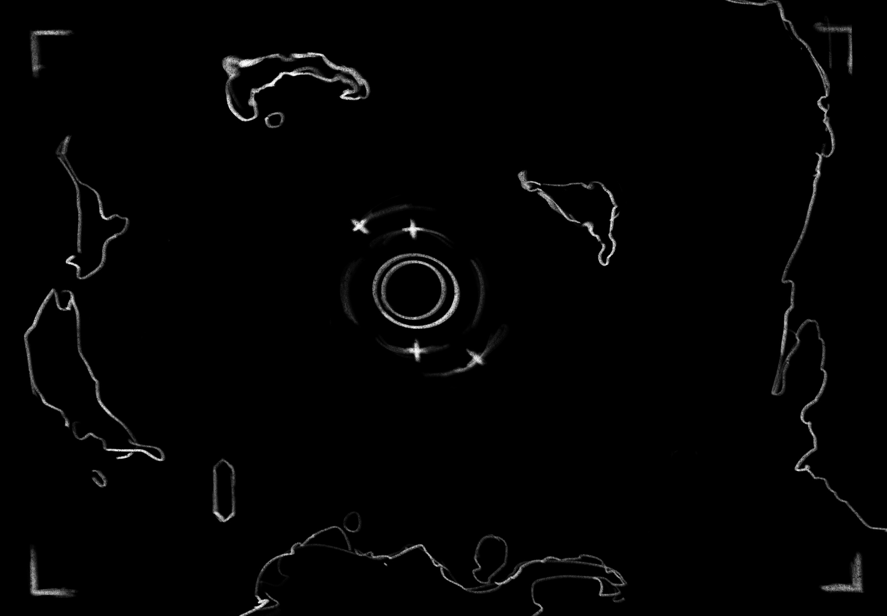

## 18th November 2026 
I started this project while in the mood for some cosmic horror. My first idea was an entity with no memory that protects people from Cthulhu’s call. It's a corpless entity that saves sailor and keeps the priest locked in its tomb.

After reading the whole book for the first time, I changed the sailors into cultists, because in the story they’re the ones worshipping him. Saving them didn’t make sense anymore, so now the game makes them forget. A few smaller things changed the same way.

For a while I was an Old One buried under the earth. I dropped that today. Now the player is an uknown entity that buried Cthulhu the first time and forgot how. I like this better because the memory theme carries the whole game.

Playing Dawnfolk gave me the idea of nothingness and monoliths. That’s where the ending came from: a monolith covered in tally marks from every loop you already lost. When you finally win, you carve the last one yourself.

The idea had gotten pretty ambitious. I removed the islands. The map is now a polar grid with R’lyeh at the pole. You lead sailors to memory shrines, and R’lyeh only works once everyone has forgotten. I also sketched the map. I still don’t know how to tell the story in the game, or what I look like as the player.

