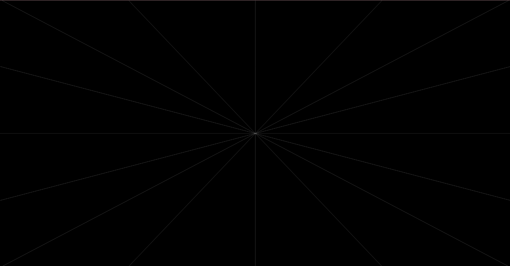
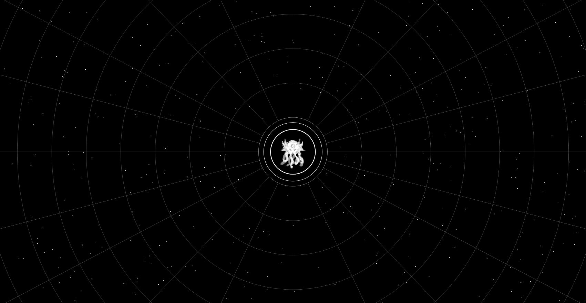
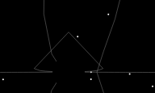
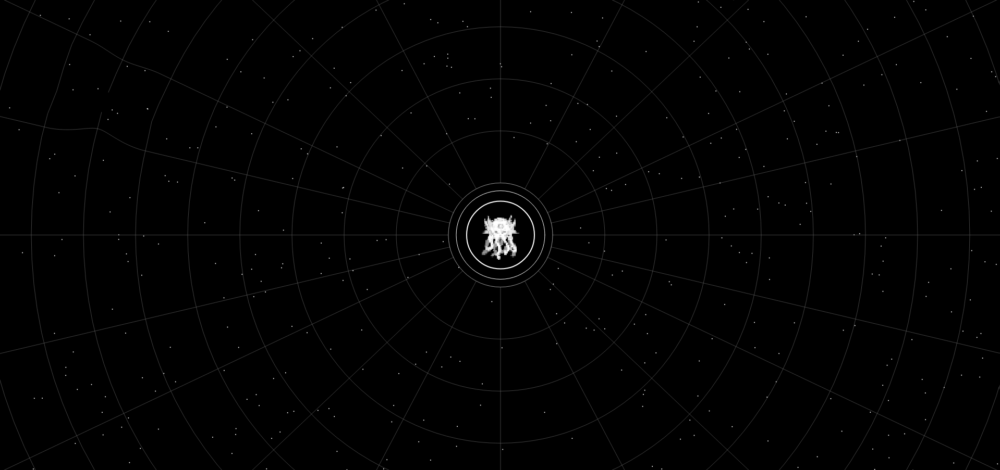

## 18th November 2026 
I started this project while I was kind of in the mood for some cosmic horror. My first idea was an entity with no memory that protects people from Cthulhu's call. It's a bodiless entity that saves sailors and keeps the priest locked in its tomb.

After reading the whole book for the first time, I changed the sailors into cultists, because in the story they're the ones actually worshipping him. So saving them didn't really make sense anymore, and now the game makes them forget instead. A few smaller things changed kind of the same way.

For a while I was an Old One buried under the earth, but I dropped that today. Now the player is an unknown entity that buried Cthulhu the first time and forgot how. I think I like this better because the memory theme kind of carries the whole game.

Playing Dawnfolk gave me the idea of nothingness and monoliths, and that's where the ending came from. There's a monolith covered in tally marks from every loop you already lost, and when you finally win, you carve the last one yourself.

The idea had gotten pretty ambitious, so I removed the islands. The map is now a polar grid with R'lyeh at the pole. You lead sailors to memory shrines, and R'lyeh only works once everyone has forgotten. I also sketched the map. I still don't really know how to tell the story in the game, or what I look like as the player.

## 21st November 2026
After about 2 weeks of sketching and just coming up with the idea and reading the materials that I thought were necessary for starting this project, I felt like I was kind of falling behind, where people already started doing their prototypes and their final projects, but I was just really fixated on how realistic my game is and how achievable it is, or even how good the idea was. So the past few days I started coding, and even though I'm not really fixated on the end idea yet, I think that coding really helps me be familiar with the scope that I'm working with. So I think it's a really good decision for me to start coding right now, so that I know at what speed I'm actually working through this, and which aspects I think are more meaningful in building the project as well as playing it.

I started coding the background. It's not something that has to do with the changes that I'm super conflicted with right now, so I think it's a good start. I did a canvas the size of the window, with a black background and a starry background as well. It's supposed to be an ocean, but I think it would help me locate my entity at that time. And then in the process of brainstorming, I also did some pixel art just to be productive enough and not leave some stuff last minute. So I did Cthulhu, which I put in the middle within R'lyeh, and a grid that kind of looks like a pole. And then that was it until a few days ago.

But today I wanted to play around a little bit with loops and `bentLine()` and some functions that we haven't seen in class, such as `beginShape()` and `vertex()`, which I think was really fun, because right now, instead of having a static grid, I have a grid that warps around the entity. So I don't have to express the entity as something concrete, but more just something you can't see but has an effect on the surroundings of the game. I think it was the most fun of this process so far.

I think that it's also a very not so explicit process, because how I did it is that I "took" a line, but the line is drawn dot by dot. So instead of having, oh, this is the start point and this is the end point, I have a function that's called `bentLine()`, where it draws a line with its length divided by 5. So say I have 800, it's divided into 160 steps, so 161 points. And every frame, each dot is drawn at its original position. However, to have the warping effect, I have a condition that verifies the distance between the entity and each dot, and it changes the dot's position closer to the entity depending on that distance. So after the line is drawn and the dots' positions are put, it looks like the line is smoothly bent towards the entity whenever it passes by, and every frame when the entity moves, the line gets redrawn and the positions get checked. And if it's not within the reach anymore, then the dots are just drawn in their normal positions.

I think this is one of my most creative decisions in the code so far, outside of the story and the game design and everything. And I'm really proud of it. I really thought about it for a long time. And I also really like how I came around to the idea of making the entity kind of invisible, because that's one thing I was really struggling with on the artistic side: who is the entity, how am I going to draw it, and what does it represent? And no, it doesn't represent anything, and that was kind of my original plan to begin with, so I'm really proud of it.

## 25th November 2026
Today I'm going to work on the shrines. I am thinking of making them appear randomly in different places every game, according to certain rules. I wanted it so that the game is always playable even after you've finished a round, and so you can play it over and over and over again. That's just a way for me to apply game design strategies to this.

I was also thinking of doing a story narrative before the entire screen loads, so that the players have a little bit of context, and also so it's not just a raw game that begins and you don't know what you're doing.
